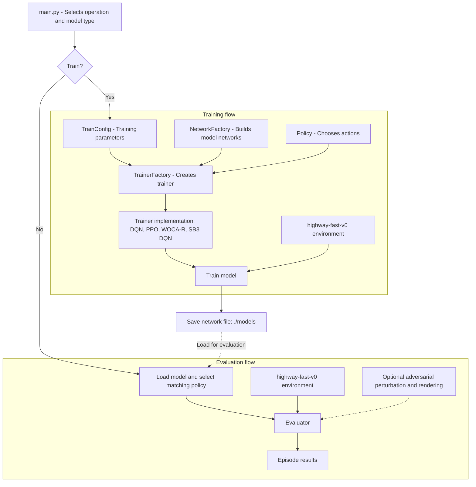

# Autonomous Driving Project

This project trains and evaluates reinforcement-learning agents in the
`highway-fast-v0` environment from `highway-env`. The command-line entry point
is `src/main.py`.

## Project structure



## Setup

Use Python and install the dependencies from the repository root:

```powershell
pip install -r requirements.txt
```

The requirements file is a pinned environment snapshot; GPU
support and availability of every pinned package can depend on your platform (especially GPU support for pytorch).

## Command line

Run these commands from the repository root. Training is enabled with
`--train`; without it, the program loads a model and evaluates it for 100
episodes.

### Train a model

```powershell
py src/main.py --train --model_type dqn
```

The supported `--model_type` values are:

| Value       | Trainer / model              |
| ----------- | ---------------------------- |
| `dqn`       | Project's custom DQN         |
| `wocar_dqn` | Robust WOCA-R DQN            |
| `ppo`       | Project's PPO implementation |
| `sb3_dqn`   | Stable-Baselines3 DQN        |

Examples:

```powershell
py src/main.py --train --model_type ppo --net_file models\ppo-agent.pt
py src/main.py --train --model_type wocar_dqn --net_file models\wocar-agent.pt
py src/main.py --train --model_type sb3_dqn --net_file models\sb3-agent.zip
```

Custom DQN, WOCA-R, and PPO checkpoints are saved as PyTorch network weights.
Stable-Baselines3 saves its model in its own archive format. Choose a separate
`--net_file` when you do not want to overwrite the default
`models/targetNetwork_trained` checkpoint.

Training parameters are initialized in `src/main.py`. An optional JSON file
can override `TrainConfig` values:

```powershell
py src/main.py --train --model_type dqn --config path\to\config.json
```

For example, a config file can contain:

```json
{
  "iterations": 500,
  "learning_rate": 0.0005,
  "seed": 123
}
```

### Evaluate a model

Evaluation is the default mode. Use the same model type and checkpoint path
that were used when training:

```powershell
py src/main.py --model_type dqn --net_file models\targetNetwork_trained
py src/main.py --model_type ppo --net_file models\ppo-agent.pt
py src/main.py --model_type sb3_dqn --net_file models\sb3-agent.zip
```

By default the evaluator runs without a rendered window and reports success,
crash, and action counts. To display the environment, add `--render_human`;
`--render_delay` sets a delay in seconds between simulation steps:

```powershell
py src/main.py --model_type dqn --net_file models\targetNetwork_trained --render_human --render_delay 0.05
```

To evaluate with the FGSM adversarial perturbation, add `--adversarial`.
`--attack_bound` sets its perturbation bound (default `0.2`):

```powershell
python src/main.py --model_type dqn --net_file models\targetNetwork_trained --adversarial --attack_bound 0.1
```

### Available options

| Option                                 | Description                                                    |
| -------------------------------------- | -------------------------------------------------------------- |
| `--train`                              | Train and save a model instead of evaluating one.              |
| `--model_type {dqn,sb3_dqn,wocar_dqn,ppo}` | Select the training/evaluation model. Defaults to `dqn`.   |
| `--net_file PATH`                      | Checkpoint path to load for evaluation or save after training. |
| `--config PATH`                        | JSON file containing training configuration overrides.         |
| `--seed INTEGER`                       | Set the training/evaluation seed.                              |
| `--render_human`                       | Render the environment during evaluation.                      |
| `--render_delay SECONDS`               | Delay between evaluation steps.                                |
| `--adversarial`                        | Enable FGSM perturbations during evaluation.                   |
| `--attack_bound FLOAT`                 | Set the adversarial perturbation bound.                        |
