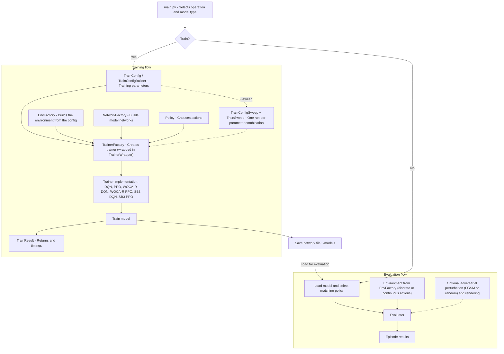

# Autonomous Driving Project

This project trains and evaluates reinforcement-learning agents in the
`highway-fast-v0` environment from `highway-env`. The command-line entry point
is `src/main.py`.

## Project structure



Source layout:

| Directory           | Content                                                                    |
| ------------------- | -------------------------------------------------------------------------- |
| `src/Trainers/`     | Trainers (`DQNTrainer`, `PPOTrainer`, `WocaRDQN`, `WocaRPPO`), buffers, `TrainConfig`, `TrainConfigSweep`, `TrainSweep`, `TrainerFactory`, `TrainerWrapper` |
| `src/Networks/`     | Networks (`StateOnlyNN`, `ActorNetwork`, `CriticNetwork`, `WocaPPONN`) and `NetworkFactory` |
| `src/Policies/`     | `CustomPolicy` (value-based) and `PPOPolicy` (discrete or continuous)      |
| `src/Adversarial/`  | Observation attacks: `FGSMAdversarial`, `RandomAdversarial`, `NeutralAdversarial` |
| `src/Environments/` | `CustomHighwayEnv` (registered as `custom-highway-v0`) and `CustomVehicle` |
| `src/Evaluator/`    | `Evaluator` and `EvalResult`                                               |
| `src/Utils/`        | `EnvFactory`, `Results`, `ResultsTable`, `Timer`                           |

## Setup

Use Python and install the dependencies from the repository root:

```powershell
pip install -r requirements.txt
```

The requirements file is a pinned environment snapshot; GPU
support and availability of every pinned package can depend on your platform (especially GPU support for pytorch).

## Command line

Run these commands from the repository root. Training is enabled with
`--train`; without it, the program loads a model and evaluates it for 100
episodes.

### Train a model

```powershell
py src/main.py --train --model_type dqn
```

The supported `--model_type` values are:

| Value       | Trainer / model                        |
| ----------- | -------------------------------------- |
| `dqn`       | Project's custom DQN                   |
| `wocar_dqn` | Robust WOCA-R DQN                      |
| `ppo`       | Project's PPO implementation           |
| `wocar_ppo` | Robust WOCA-R PPO                      |
| `sb3_dqn`   | Stable-Baselines3 DQN                  |
| `sb3-ppo`   | Stable-Baselines3 PPO (vectorized envs)|

Examples:

```powershell
python src/main.py --train --model_type ppo --net_file models\ppo-agent.pt
python src/main.py --train --model_type wocar_ppo --net_file models\wocar-ppo-agent.pt
python src/main.py --train --model_type sb3-ppo --net_file models\sb3-ppo-agent.zip
```

Custom DQN, WOCA-R, and PPO checkpoints are saved as PyTorch network weights
(the actor network for the PPO variants, the robust network for the WOCA-R
ones). Stable-Baselines3 saves its model in its own archive format and also
writes its best model and evaluation logs to `./logs/`. Choose a separate
`--net_file` when you do not want to overwrite the default
`models/targetNetwork_trained` checkpoint.

Training parameters are initialized in `src/main.py` through
`TrainConfigBuilder`. An optional JSON file can override `TrainConfig` values:

```powershell
python src/main.py --train --model_type dqn --config path/to/config.json
```

For example, a config file can contain:

```json
{
  "iterations": 500,
  "learning_rate": 0.0005,
  "seed": 123
}
```

#### Continuous actions (PPO)

`--continuous` switches the PPO trainers and the evaluator to the
`ContinuousAction` space of `highway-env`. It sets `ppo_continuous` on the
config, which makes `EnvFactory` build a continuous environment and
`NetworkFactory` build a Gaussian actor:

```powershell
python src/main.py --train --model_type ppo --continuous --net_file models\ppo-continuous.pt
python src/main.py --model_type ppo --continuous --net_file models\ppo-continuous.pt
```

Use the same flag for training and evaluation: a checkpoint trained in
continuous mode does not load into the discrete actor.

#### Parallel sample collection (PPO)

The project's PPO collects its rollout buffer either sequentially or in
several worker processes. `--parallel` (training only) enables the parallel
path, which splits `buffer_size` over `ppo_nworkers` processes
(the worker count is rounded down to a divisor of `buffer_size`):

```powershell
python src/main.py --train --model_type ppo --parallel
```

Each worker builds its own environment from the same config, so collection
stays identical to the sequential path.

### Parameter sweeps

A sweep trains the same model several times, once per combination of the
parameters you vary, and keeps one result per run. It is built from two
classes:

- `TrainConfigSweep` takes a base `TrainConfig` and records the parameters to
  vary. `vary(name, values)` adds one parameter (the name must exist on
  `TrainConfig`), and `seeds(n)` is a shortcut that varies `seed` over `n`
  random seeds (or over an explicit list). `configs()` yields the cartesian
  product of all varied values as `(overrides, config)` pairs.
- `TrainSweep` runs them: for each point it builds a trainer with
  `TrainerFactory`, calls `learn()`, names the result after the run's
  overrides, optionally saves the model, and returns the list of
  `(overrides, config, result)` tuples.

The sweep is launched with `--train --sweep`, and `--model_dir` sets the
existing directory where one checkpoint per run is written (default
`./models`):

```powershell
python src/main.py --train --sweep --model_type ppo --model_dir models
```

Each file is named after the sweep name, the model type, the run's overrides
and its index, for example
`eps-sweep_ppo_attack_budget-0.05_seed-1234567890_3.pt`.

The sweep itself is defined in `src/main.py`; edit that call to choose what to
vary. The current one sweeps the attack budget over two seeds (6 runs):

```python
sweep = TrainConfigSweep(train_config).vary("attack_budget", [0.0, 0.05, 0.1]).seeds(2)
runs = TrainSweep(sweep, trainer_type=MODEL_TYPE, model_dir=MODEL_DIR, name="eps-sweep").run()
```

Any other `TrainConfig` field can be varied the same way, and calls chain:

```python
sweep = (
    TrainConfigSweep(train_config)
    .vary("learning_rate", [1e-4, 5e-4])
    .vary("ppo_clip_epsilon", [0.1, 0.2])
    .seeds([1, 2, 3])
)
```

Note that the sweep is still an experimental feature: the number of runs is
the product of all varied lists, so keep the lists and `iterations` small
before launching a long sweep.

### Evaluate a model

Evaluation is the default mode. Use the same model type and checkpoint path
that were used when training:

```powershell
python src/main.py --model_type dqn --net_file models\targetNetwork_trained
python src/main.py --model_type ppo --net_file models\ppo-agent.pt
python src/main.py --model_type sb3_dqn --net_file models\sb3-agent.zip
```

By default the evaluator runs without a rendered window and reports success,
crash, and action counts. To display the environment, add `--render_human`;
`--render_delay` sets a delay in seconds between simulation steps:

```powershell
python src/main.py --model_type dqn --net_file models\targetNetwork_trained --render_human --render_delay 0.05
```

To evaluate with an adversarial perturbation of the observations, add
`--adversarial`. `--attack_type` selects the attack (`fgsm`, the default, or
`random`) and `--attack_bound` sets its perturbation bound (default `0.2`):

```powershell
python src/main.py --model_type dqn --net_file models\targetNetwork_trained --adversarial --attack_bound 0.1
python src/main.py --model_type dqn --net_file models\targetNetwork_trained --adversarial --attack_type random
```

`--attack_bound` is not an absolute perturbation size: it is a fraction of the
average value of each observation feature. Both attacks compute, once, the
mean over the rows (the vehicles) of the observation for every feature, and
scale the perturbation of that feature by `attack_bound * mean_feature`. The
bound is therefore fixed, but relative to a realistic magnitude per feature,
so a given `--attack_bound` perturbs features of different scales (positions,
speeds, ...) by a comparable proportion instead of overwhelming the small ones.

### Available options

| Option                                 | Description                                                    |
| -------------------------------------- | -------------------------------------------------------------- |
| `--train`                              | Train and save a model instead of evaluating one.              |
| `--model_type {dqn,sb3_dqn,wocar_dqn,ppo,wocar_ppo,sb3-ppo}` | Select the training/evaluation model. Defaults to `dqn`. |
| `--net_file PATH`                      | Checkpoint path to load for evaluation or save after training. |
| `--model_dir PATH`                     | Directory where a sweep saves one model per run (default `./models`). Only used with `--sweep`. |
| `--config PATH`                        | JSON file containing training configuration overrides.         |
| `--seed INTEGER`                       | Set the training/evaluation seed.                              |
| `--continuous`                         | Use the continuous action space (PPO only), for training and evaluation. |
| `--sweep`                              | Run the parameter sweep defined in `main.py` instead of a single training run (experimental). |
| `--parallel`                           | Collect PPO samples in parallel worker processes (training only). |
| `--render_human`                       | Render the environment during evaluation.                      |
| `--render_delay SECONDS`               | Delay between evaluation steps.                                |
| `--adversarial`                        | Enable adversarial perturbations during evaluation.            |
| `--attack_type {fgsm,random}`          | Select the adversarial attack. Defaults to `fgsm`.             |
| `--attack_bound FLOAT`                 | Set the adversarial perturbation bound.                        |
